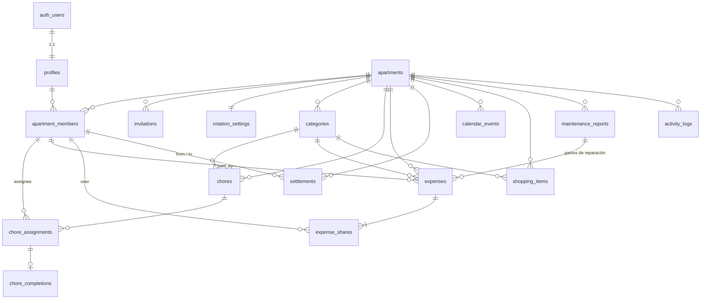

# Modelo de datos

Migraciones en [`supabase/migrations`](../supabase/migrations):

| Archivo | Contenido |
|---|---|
| `20261124000001_schema.sql` | Tablas, claves, restricciones, índices, `updated_at` |
| `20261124000002_functions.sql` | Helpers de membresía, RPCs, triggers (perfil, completados, cuadre de gastos, estados, historial), vista `member_balances`, permisos de funciones |
| `20261124000003_rls.sql` | Row Level Security y privilegios por columna |
| `20261124000004_storage_realtime.sql` | Bucket privado `maintenance-photos` con políticas, publicación Realtime |
| `20261125000001_grants.sql` | Permisos explícitos de tabla para usuarios autenticados (los proyectos nuevos de Supabase ya no los dan solos) |

## Diagrama entidad-relación

## Tablas

| Tabla | Propósito | Notas |
|---|---|---|
| `profiles` | Identidad visible de cada usuario | Creada por trigger al registrarse |
| `apartments` | El hogar | `currency` (COP), `max_members` (3) |
| `apartment_members` | Pertenencia y rol (`owner`/`member`) | PK `(apartment_id, user_id)`; `left_at` en lugar de borrar |
| `invitations` | Códigos de invitación | Código único aleatorio, caducidad, usos, revocación |
| `categories` | Categorías por módulo (`chore`/`expense`/`shopping`) | Nombre único por apartamento y módulo |
| `chores` | Definición de tareas | Frecuencia, día límite, esfuerzo, `rotation_offset`, archivado |
| `rotation_settings` | Orden de rotación y ancla | Una fila por apartamento |
| `chore_assignments` | Turnos concretos por semana | `UNIQUE (chore_id, week_start, occurrence)`; `original_assignee_id` |
| `chore_completions` | Quién completó y cuándo | Trigger sincroniza `status` del turno |
| `expenses` | Gastos | `amount BIGINT > 0`; opcionalmente ligado a un reporte |
| `expense_shares` | Parte de cada integrante | Suma = monto (constraint trigger diferido) |
| `settlements` | Pagos entre roomies | `from_user <> to_user`; inmutables (crear/borrar) |
| `calendar_events` | Eventos, pagos, recordatorios | Recurrencia, visibilidad `shared`/`private` |
| `shopping_items` | Lista de mercado | Coherencia `status`/`purchased_at` |
| `maintenance_reports` | Daños | Hasta 6 rutas de foto; `resolved_at` automático |
| `activity_logs` | Historial | Escrito solo por triggers; diff de cambios en `changes` |

## Funciones (RPC)

| Función | Uso |
|---|---|
| `create_apartment(name, currency)` | Crea apartamento + dueño + rotación + categorías por defecto |
| `invitation_preview(code)` | Nombre y cupo del apartamento antes de unirse |
| `accept_invitation(code)` | Unirse (valida caducidad, usos, cupo; idempotente si ya eres miembro) |
| `leave_apartment`, `remove_member`, `transfer_ownership` | Gestión de membresía |
| `swap_assignments(a, b)` | Intercambio de turnos pendientes de la misma semana |
| `create_expense(...)`, `update_expense(...)` | Gasto + partes en una sola transacción |
| `split_equally(amount, participants)` | División exacta con reparto de residuos |
| Vista `member_balances` | Saldo neto por integrante (`security_invoker`) |

## Cómo se verifican

`npm run test:db` ejecuta las migraciones reales sobre PostgreSQL embebido (PGlite) con un sustituto mínimo de Supabase (`auth.uid()`, roles) y comprueba: onboarding e invitaciones, aislamiento entre apartamentos, FKs compuestas, privilegios por columna, división y saldos, rechazo de partes descuadradas, sincronización de completados, intercambios, eventos privados, historial de daños, salida de integrantes y borrado en cascada.
